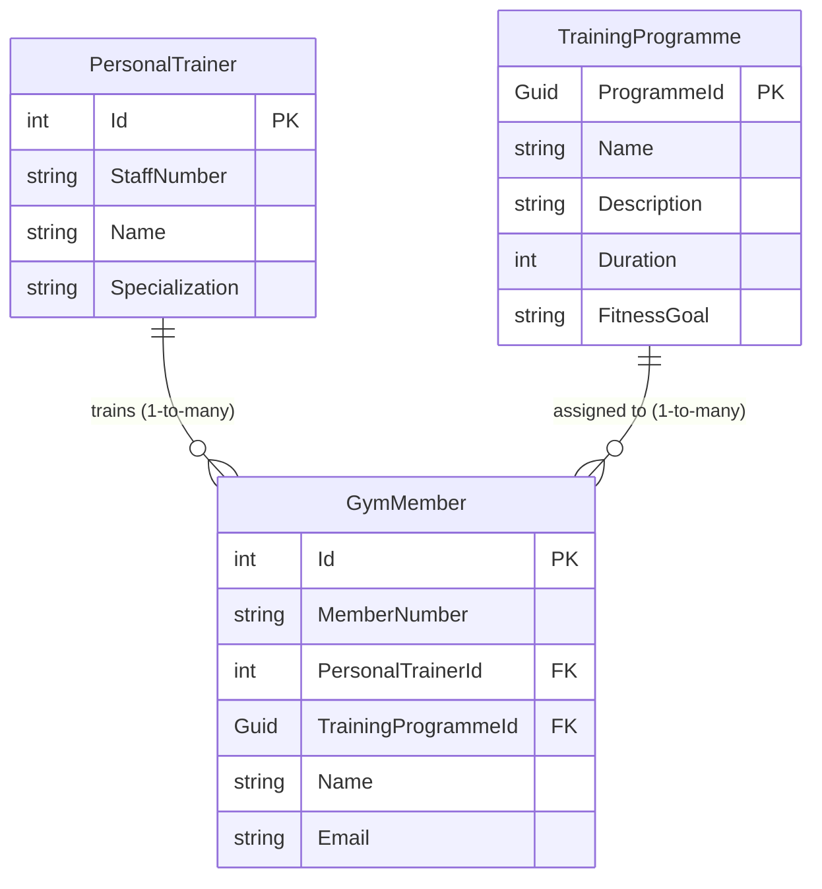

# Member 3 — Training Programmes & Entity Relationships Documentation

**Author:** Member 3 (Training Programmes & Assignments)  
**Project:** FitCore Gym Management System  
**Technology:** ASP.NET Core Web API + EF Core Code-First + SQL Server + React

---

## Scope of Member 3

Member 3 is responsible for:

- The `TrainingProgramme` entity, DTOs, controller CRUD, and assignment endpoints
- The `GymMember` → `TrainingProgramme` relationship (`TrainingProgrammeId` foreign key)
- The Admin assignment of a trainer to a member (`PersonalTrainerId`) via the TrainingProgramme controller
- The member-facing view of the assigned programme

**WorkoutPlan is not implemented by Member 3.** WorkoutPlan belongs to another group member. Member 3 only provides the `TrainingProgramme` side that a future WorkoutPlan module can relate to (the programme primary key `ProgrammeId`). This documentation does **not** describe WorkoutPlan as if it exists in the current codebase.

---

## 1. TrainingProgramme Entity & Fields

The `TrainingProgramme` entity represents a structured workout regime offered by the gym. Administrators create and maintain programmes and assign them to gym members.

### Entity class (`GymManagement.Core/Entities/TrainingProgramme.cs`)

| Field | Type | Constraint | Purpose |
|---|---|---|---|
| `ProgrammeId` | `Guid` | Primary key (`[Key]`) | Unique identifier, set with `Guid.NewGuid()` on create. |
| `Name` | `string` | Required, max 100 characters | Programme title. |
| `Description` | `string?` | Optional (nullable) | Extra detail about the programme. May be omitted. |
| `Duration` | `int` | Required | Length of the programme in weeks. Create/update DTOs also restrict this to 1–104. |
| `FitnessGoal` | `string` | Required; allowed values only | Target goal. Must be exactly one of: `Weight Loss`, `Muscle Building`, `General Fitness`, `Strength`, `Endurance`. |
| `GymMembers` | `ICollection<GymMember>` | Navigation | Members currently assigned to this programme. |

### DTOs

Create and update use `AddTrainingProgrammeDto` and `UpdateTrainingProgrammeDto`.

- Incoming programme title is bound as `ProgrammeName` on the DTO and mapped onto entity property `Name` in the controller.
- `Description` is optional (`string?`) on both DTOs.
- `FitnessGoal` uses `[AllowedValues]` for the five exact strings listed above.
- Entity property names are **not** renamed to match DTO names (`Name` stays `Name`; `ProgrammeId` stays `ProgrammeId`).

---

## 2. DbContext naming

`ApplicationDbContext` exposes a **single** `DbSet` for programmes. The working controller uses the camelCase set name:

```csharp
public DbSet<TrainingProgramme> trainingProgrammes { get; set; }
```

EF Core maps this to the `TrainingProgramme` table (singular table name in the current model snapshot).

Related sets already in the context:

- `DbSet<GymMember> GymMembers`
- `DbSet<PersonalTrainer> PersonalTrainers`

---

## 3. System entity relationships (as implemented)



### Trainer → Member (`1 : N`)

- One `PersonalTrainer` can train many `GymMember`s.
- Each member has at most one assigned trainer.
- **Foreign key on `GymMember`:** `PersonalTrainerId` (`int?`) → `PersonalTrainer.Id`
- **Navigation:** `GymMember.PersonalTrainer` and `PersonalTrainer.AssignedMembers`

### Member → Programme (`N : 1`)

- Many members can share the same `TrainingProgramme`.
- Each member has at most one assigned programme at a time.
- **Foreign key on `GymMember`:** `TrainingProgrammeId` (`Guid?`) → `TrainingProgramme.ProgrammeId`
- **Navigation:** `GymMember.TrainingProgramme` and `TrainingProgramme.GymMembers`

### WorkoutPlan (other member — not in this implementation)

WorkoutPlan is another group member’s module. It is **not** present as an entity, DbSet, Fluent API relationship, or UI in this Member 3 work. When that member implements it, they can attach WorkoutPlan to `TrainingProgramme.ProgrammeId`. Member 3 does not own that relationship configuration.

---

## 4. Fluent API (`OnModelCreating`)

Relationships that actually exist in `ApplicationDbContext`:

```csharp
builder.Entity<GymMember>()
    .HasIndex(m => m.MemberNumber)
    .IsUnique();

builder.Entity<PersonalTrainer>()
    .HasIndex(t => t.StaffNumber)
    .IsUnique();

builder.Entity<GymMember>()
    .HasOne(m => m.PersonalTrainer)
    .WithMany(t => t.AssignedMembers)
    .HasForeignKey(m => m.PersonalTrainerId)
    .OnDelete(DeleteBehavior.SetNull);

builder.Entity<GymMember>()
    .HasOne(m => m.TrainingProgramme)
    .WithMany(p => p.GymMembers)
    .HasForeignKey(m => m.TrainingProgrammeId)
    .OnDelete(DeleteBehavior.SetNull);
```

### Delete behaviour used here

- **`DeleteBehavior.SetNull`** on both FKs: deleting a trainer or a programme does not delete the member. `PersonalTrainerId` / `TrainingProgrammeId` is set to `NULL`.

There is no Fluent API for WorkoutPlan in this project.

---

## 5. API surface (existing controller)

Route prefix: `api/TrainingProgramme` (`[Route("api/[controller]")]` on `TrainingProgrammeController`). This route was left as-is and was not renamed for naming consistency.

| Method | Path | Auth | Purpose |
|---|---|---|---|
| GET | `/api/TrainingProgramme` | Authenticated | List all programmes |
| GET | `/api/TrainingProgramme/{id}` | Authenticated | Get one programme |
| POST | `/api/TrainingProgramme` | Admin | Create programme |
| PUT | `/api/TrainingProgramme/{id}` | Admin | Update programme |
| DELETE | `/api/TrainingProgramme/{id}` | Admin | Delete programme |
| POST | `/api/TrainingProgramme/assign-trainer` | Admin | Set `GymMember.PersonalTrainerId` |
| POST | `/api/TrainingProgramme/assign-programme` | Admin | Set `GymMember.TrainingProgrammeId` |
| GET | `/api/TrainingProgramme/trainer/{trainerId}` | Authenticated | Programmes assigned to a trainer’s members |
| GET | `/api/TrainingProgramme/my-programme` | GymMember, Admin | Logged-in member’s assigned programme |

The controller uses `_DbContext.trainingProgrammes` for programme CRUD (not a repository or service layer).

---

## 6. Frontend (Member 3 pages)

- Admin: programmes list, add, edit, assign trainer, assign programme
- Member: `/member/programme` shows the assigned programme (`MemberProgramme.jsx`)
- Legacy alias `/member/my-programme` uses the same `MemberProgramme` page

---

## 7. EF Core migrations (TrainingProgramme)

Existing migrations (do not recreate these):

1. `20261008104116_AddTrainingProgrammes` — creates the `TrainingProgramme` table
2. `20261008111249_AddProgrammeAssignments` — adds `GymMembers.TrainingProgrammeId` FK

A later migration may exist to make `Description` nullable after that property was changed on the entity. Apply pending migrations with:

```bash
dotnet ef database update --project backend/GymManagement.Infrastructure --startup-project backend/GymManagement.API
```
